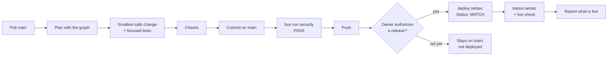

# Contributing to NetSec AI

NetSec AI is proprietary software of Networkers Home ([LICENSE.md](LICENSE.md)). Contributions come from people the
owner has given access to.

This page is the human workflow. The rules are in [CLAUDE.md](CLAUDE.md) and apply to people and AI agents alike:
the architecture guardrail, the owner's hard rules (2026-09-29) and the owner directives (2026-10-29), which win
where they conflict. Where this page and CLAUDE.md differ, CLAUDE.md wins.

## Before your first change

1. Read [CLAUDE.md](CLAUDE.md) and [docs/security/secure-development.md](docs/security/secure-development.md).
2. Set up: [docs/development.md](docs/development.md); tests: [docs/testing.md](docs/testing.md).
3. Find your way around with the code graph: `bun run graph`, then `graphify affected` ([docs/graphify.md](docs/graphify.md)).

## The workflow

1. **Start from the latest `main`** in the one shared checkout (no worktrees, no branches): `git pull origin main`.
   Others work in the same folder: never commit, revert or reformat their uncommitted files.
2. **Plan:** run `bun run graph` and `affected` on what you will change; for anything security-relevant, use the
   planning template in [docs/security/secure-development.md](docs/security/secure-development.md).
3. **Make the smallest safe change:** reuse what exists; no new dependencies, services or abstractions unless
   needed; adapt PadhAI features to NetSec rather than deleting them (nothing is deleted without the owner's
   approval).
4. **Add focused regression tests** for security and behaviour changes: a test that fails on the old code and passes
   on the new. Destructive backend tests run against isolated WSL databases whose names end in `_test`.
5. **Run the checks for what you changed:**
   - **API:** `ruff check` and `ruff format --check` (both in `bun run lint`), an import check, the focused pytest
     files (in WSL, [docs/testing.md](docs/testing.md));
   - **web app:** `bun run typecheck`, `bun run lint`, `bun run test` and `bun run build`, from `frontend/`;
   - **NetSec deploy scripts:** `bun test deploy-netsec/tests`; **Graphify wiring:** `bun run test:graph`;
   - **an API route or schema:** `bun run contract`, and commit the regenerated `docs/openapi.json` and
     `contract.gen.ts`;
   - **what the model is told:** `backend/scripts/eval_engineering.py` on the host (it uses the production key; the
     owner decides when).

   A failing check is fixed, never committed.
6. **Commit on `main`.** Write the message as the repository does: the area, then what changed for the user. One
   commit is one release of both halves, so keep a commit to one change.
7. **Run `bun run security` on the clean, committed tree.** A PASS writes the receipt that `deploy:netsec` requires
   ([docs/security/security-tools.md](docs/security/security-tools.md)). With uncommitted files present it runs in
   check-only mode and writes no receipt.
8. **Push:** `git push origin main`. Never force-push. GitHub Actions do not run (out of credit): report CI as NOT RUN.
9. **Release only with the owner's explicit authorization:** `NETSEC_DEPLOY_HOST=root@10.1.50.94 bun run
   deploy:netsec` must end with `Status: MATCH`; then `status:netsec` and a live check of what you changed
   ([docs/deployment.md](docs/deployment.md)).
10. **Report only what is true:** the commit, the checks run and their results, what is live (if released), what
    was not tested, and residual risks.

## Working beside others

- **A deploy ships all of `main`.** Don't deploy while someone else's pushed work is unverified; agree on it first.
- **Don't edit, revert or reformat other people's work in progress.** If you find a problem in it, tell them.
- **One checkout:** the owner does not want separate git worktrees; coordinate instead.

## Documentation

- **Update the page that is the authority for what you changed** ([docs/README.md](docs/README.md) lists them).
- **Describe only what the code does.** Link to the code, and date anything that can change outside git, such as
  production's settings. Mark what you could not verify.

## Never

- **Open, print, commit or paste a secret:** the root key files (`dummy_acc.txt`, `git.txt`, `google_auth.txt`,
  `ollalink.txt`, `ollastack.txt`, `ollima.txt`, `openrouter.txt`), any `.env*` file, or a credential you came
  across.
- **Change production without authorization**, edit files on the server by hand, run migrations outside a deploy,
  or run `docker compose down -v` there. **Never touch PadhAI's production** on the same host.
- **Use real users' data** in tests, screenshots or examples. Use `@example.com` addresses and made-up configs.

## Security problems

Report them privately, as [SECURITY.md](SECURITY.md) describes. Never in a public issue.
