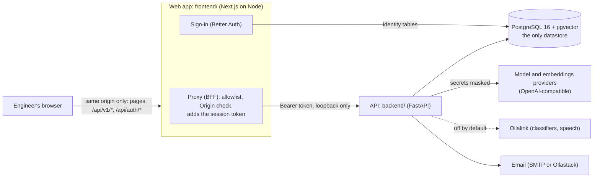

# NetSec AI

**An assistant for network, security and infrastructure engineers.**

NetSec AI is a chat assistant for engineers who build, run and secure networks: routing and switching, firewalls and
VPNs, wireless, SD-WAN, data center and cloud, Linux and Windows, SOC/SIEM and incident response, authorised
penetration testing, DevSecOps and automation. Paste a config, a log or an error and it answers like a senior
engineer: the likely cause or the fix first, exact commands in code blocks, how to verify, the risks and how to roll
back (the frozen prompt is `SYSTEM_PROMPT` in [`backend/app/chat/assistant.py`](backend/app/chat/assistant.py)).

This repository is the NetSec fork of **PadhAI**, a Class 6–12 school tutor by the same owner (Networkers Home).
PadhAI's features were adapted for engineers rather than deleted: certification practice, a practice streak, a lab
timer, Skills & Certifications, the Troubleshooter (preview) and an Engineering Profile.

**This repository is the whole application:** the web app (`frontend/`), the API (`backend/`), NetSec's deployment
(`deploy-netsec/`) and the documentation (`docs/`). One commit of `main` is one release of both halves.

## Contents

1. [What works today](#what-works-today)
2. [Architecture](#architecture)
3. [Getting started](#getting-started)
4. [Commands](#commands)
5. [Deployment](#deployment)
6. [Limitations](#limitations)
7. [Documentation](#documentation)
8. [Licence](#licence)

## What works today

Checked against the code on 2026-10-29. Production settings are the owner's and can differ; `bun run status:netsec`
shows what production runs.

| Area | What an engineer gets | State in the code |
|---|---|---|
| Chat | Answers streamed word by word, Stop, Regenerate, Copy, feedback; Markdown, code with filenames, tables, mermaid diagrams | On |
| Secret masking | Passwords, keys, SNMP communities and pre-shared keys in pasted text become `<redacted>` before any model or embeddings provider sees them ([`backend/app/llm/redact.py`](backend/app/llm/redact.py)) | On (pattern-based; Ollalink requests are not masked) |
| Engineering Profile | Role, experience, focus areas, platforms and certification goal shape every answer | On (`/v1/engineering/profile`, Settings › Engineering Profile; the web page was added in the working tree on 2026-10-29) |
| Own files | PDF, Office files, CSV, text and images (OCR) in the File Library, read in a sandbox and cited | On |
| Knowledge base | Retrieval over the owner's documents in pgvector, with citations | Pipeline ready; **no content yet** |
| Skills & Certifications, practice streak, Lab Activity | The practice record, streak and lab timer | On; certification questions pending (the bank still holds PadhAI content) |
| Interactive widgets and chat tests | MCQ, quiz, fill-blank, flashcards, graphs, diagrams; tests from the question bank | Rendered; the model is taught them only with `TUTOR_INTERACTIVE_BLOCKS` (off) |
| Memory | Explicit personal memories the user manages | APIs on; recall and automatic proposals off |
| Sign-in | Email code or password, optional Google, two-step sign-in, adaptive CAPTCHA, breached-password check | On (Google and Turnstile only when configured) |
| Intent router, scope filter, voice | Ollalink classifiers and speech | Off by default (`INTENT_ROUTER`, `STUDY_SCOPE`, `VOICE_MODE`) |
| Troubleshooter, Summarizer | Sample-data pages | Preview only (`PREVIEW_FEATURES=1`, never in production) |

## Architecture



- **The browser never calls the API.** The web app's server checks each request against an allowlist, adds the
  session token from an httpOnly cookie and forwards it; the token never reaches page code.
- **The API enforces every rule:** it checks the session and that the data belongs to the user, and keeps all data
  (vectors and uploaded files included) in PostgreSQL.
- **A chat turn** is one model call through a LangGraph graph: prepare (quotas, the user's profile), retrieve (never
  fails a turn), assemble the context within a character budget, generate and stream over SSE.
- **Production** is one Ubuntu VM under systemd, behind a Cloudflare Quick Tunnel; a deploy rebuilds and restarts
  only what a commit changed.

The reference is [CLAUDE.md](CLAUDE.md) (current) and [docs/architecture.md](docs/architecture.md); the security model
is [docs/security/README.md](docs/security/README.md).

**Technology:** Next.js 15, React 19, TypeScript, Tailwind, Radix, Better Auth (web); Python 3.12, FastAPI,
SQLAlchemy (async) + asyncpg, Alembic, LangGraph/LangChain (API); PostgreSQL 16 + pgvector. Runtimes are pinned in
`.bun-version` (Bun 1.3.14) and `.node-version` (Node 24.19.0); dependencies in `frontend/bun.lock` and the hashed
`backend/requirements.lock`.

## Getting started

You need Git, Python 3.12, Bun 1.3.14 and Node 24.

```sh
git clone https://github.com/rockyNH703/AI-Tutor-NH.git && cd AI-Tutor-NH   # private: needs access
bun run setup     # backend/.venv + requirements, backend/.env from its example, frontend packages
```

- **With Docker** (not on the owner's PC): `bun run dev` starts PostgreSQL + pgvector and Mailpit
  (`docker-compose.dev.yml`), runs the migrations, then the API on `:4000` and the web app on `:3000`.
- **On the owner's PC (no Docker):** the frontend checks run on Windows with Bun; the backend tests run in WSL Ubuntu
  24.04 against an isolated PostgreSQL 16 + pgvector cluster ([docs/testing.md](docs/testing.md)).
- Local settings: `backend/.env` (`LLM_PROVIDER=fake` and `EMBEDDING_PROVIDER=fake` work offline) and
  `frontend/apps/app/.env.local`; the web app's sign-in needs `AUTH_DATABASE_URL`, `BETTER_AUTH_SECRET` and the
  same `AUTH_INTERNAL_TOKEN` as the API ([docs/environment-variables.md](docs/environment-variables.md)).

The step-by-step guide ([docs/beginner-guide.md](docs/beginner-guide.md)) was written for PadhAI with Docker; its
commands still apply where Docker exists.

## Commands

```sh
bun run lint        # ruff (check + format) for the API, Biome for the web app
bun run test        # backend pytest (needs a *_test database), frontend typecheck + unit tests, deploy-netsec tests
bun run build       # is docs/openapi.json current? then the web app's production build
bun run contract    # regenerate the API contract and the web app's contract types, then their tests
bun run security    # the local security gate (Semgrep, gitleaks, pip-audit, bun audit, zizmor): must PASS before a push
bun run graph       # the code knowledge graph (Graphify), local only
```

How to contribute, with the rules and checks: [CONTRIBUTING.md](CONTRIBUTING.md) and [CLAUDE.md](CLAUDE.md).

## Deployment

Only with the owner's explicit authorization:

```sh
git push origin main                                       # after bun run security PASSed on this commit
NETSEC_DEPLOY_HOST=root@10.1.50.94 bun run deploy:netsec   # GitHub main -> production; ends "Status: MATCH"
NETSEC_DEPLOY_HOST=root@10.1.50.94 bun run status:netsec   # read-only: health, tunnel URL, MATCH or MISMATCH
NETSEC_DEPLOY_HOST=root@10.1.50.94 bun run rollback:netsec # the previous commit, the same way
```

How it works: [docs/deployment.md](docs/deployment.md), [docs/rollback.md](docs/rollback.md),
[docs/operations.md](docs/operations.md); the host: [INFRASTRUCTURE.md](INFRASTRUCTURE.md). The host also runs
PadhAI's production, which NetSec's scripts refuse to touch; `deploy/` is PadhAI's deploy and refuses to run here.

## Limitations

- **No CI:** GitHub Actions do not run (the account is out of credit). `bun run security` is the enforced gate; the
  test suites are run by hand.
- **No knowledge base content yet:** answers come from the model alone until the owner provides documents.
- **Certification question bank pending:** `qbank/` still holds PadhAI's NCERT content.
- **Public URL is a Quick Tunnel:** its address changes when cloudflared restarts, and sign-in breaks until
  `NEXT_PUBLIC_SITE_URL` and `PUBLIC_APP_URL` follow it.
- **Secret masking is pattern-based:** non-obvious secrets pass, and stored chats keep what the user wrote.
- **Many docs under `docs/` were written for PadhAI** (verified at `0e33ec0`, 2026-10-26) and are not yet
  re-verified for NetSec; [docs/README.md](docs/README.md) marks them.
- One host, no staging, no alerting ([INFRASTRUCTURE.md](INFRASTRUCTURE.md)).

## Documentation

| If you are | Start with |
|---|---|
| Working on the code (person or agent) | [CLAUDE.md](CLAUDE.md), [AGENTS.md](AGENTS.md), [CONTRIBUTING.md](CONTRIBUTING.md), [docs/development.md](docs/development.md), [docs/testing.md](docs/testing.md) |
| Reviewing security | [docs/security/README.md](docs/security/README.md), [SECURITY.md](SECURITY.md) |
| Operating production | [docs/deployment.md](docs/deployment.md), [docs/operations.md](docs/operations.md), [docs/rollback.md](docs/rollback.md), [docs/environment-variables.md](docs/environment-variables.md) |
| Planning | [ROADMAP.md](ROADMAP.md) |

Everything, with what is current and what is PadhAI-era: [docs/README.md](docs/README.md).

## Licence

**Copyright © 2026 Networkers Home. All rights reserved.** Proprietary, not open source: see [LICENSE.md](LICENSE.md).
Third-party components keep their own licences ([THIRD_PARTY_NOTICES.md](THIRD_PARTY_NOTICES.md)); every
dependency is listed with its version in `frontend/bun.lock` and `backend/requirements.lock`.
