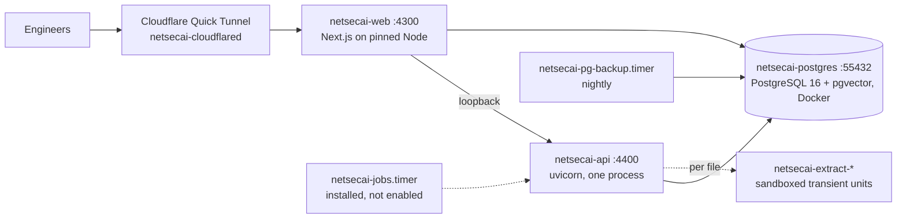

# Operations: health, logs, backups and runbooks

> NetSec AI, checked against `deploy-netsec/`, `backend/app/health.py`, `backend/app/logging.py` and the services'
> code on 2026-10-29. How to deploy, check and roll back is in [deployment.md](deployment.md) and
> [rollback.md](rollback.md). **Production changes need the owner's explicit authorization**; reading logs and
> running `status:netsec` don't. Nothing is ever edited by hand on the host.

## Contents

- [What runs in production](#what-runs-in-production)
- [Is it healthy?](#is-it-healthy)
- [Logs and what they contain](#logs-and-what-they-contain)
- [Backups and restore](#backups-and-restore)
- [Runbooks](#runbooks)

## What runs in production

One Ubuntu VM (`10.1.50.94`), shared with PadhAI's production (never touched), supervised by systemd, serving one
checkout of `main` (`/opt/netsecai/app`):

The units, ports, paths and limits are in [INFRASTRUCTURE.md](../INFRASTRUCTURE.md).

## Is it healthy?

| Check | What it tells you |
|---|---|
| `NETSEC_DEPLOY_HOST=root@10.1.50.94 bun run status:netsec` | GitHub `main` against production, the commit each part runs, both units, `/ready`, `/login`, sign-in settings present, the tunnel address against `NEXT_PUBLIC_SITE_URL` and `PUBLIC_APP_URL`, the public `/login` (200), a backup from the last 26 hours and its timer, the jobs timer, files, no legacy port listening. Must end `Status: MATCH` |
| `bun run smoke:netsec` | Today the same read-only checks as `status:netsec` (`deploy-netsec/smoke.sh`) |
| API `GET /health` | `{"status": "ok", "release", "files"}`: up, the commit it started from, whether files work |
| API `GET /ready` | The database is reachable and its schema is not behind this release's migrations (503 when either fails) |
| Web `GET /api/health` | The web server is up; for a local caller also the release and whether sign-in reaches its database |
| `deploy-netsec/infra-check.sh` (on the host) | Status, plus: every port bound to loopback only, API docs hidden, the dedicated Compose project/volume/network, no unexpected schema, a backup in the last 2 days, free disk (uploads stop under 5 GB), Tesseract `eng`+`hin`, files available |

**`MATCH`** means both parts run the production checkout's code; a part a commit didn't change keeps running an older
commit with identical code, which is still `MATCH`.

## Logs and what they contain

- **Format:** the API and the jobs worker log JSON lines (`app/logging.py`), each with a request id and, when known,
  the user id. The web app logs to its journal.
- **Never logged:** message, document or chunk text; keys; codes. Provider errors have key-like strings redacted.
- **Where:** `journalctl -u netsecai-api`, `-u netsecai-web`, `-u netsecai-cloudflared` (the tunnel's address),
  `-u 'netsecai-deploy-*'` (deploys), `-u netsecai-jobs` (when enabled).
- **Useful events:** the access line per request; `rag.retrieval` and `rag.graph` (status, reason, timings);
  generation outcomes (slow replies as warnings); the file worker's results and self-test; `started` (environment,
  LLM, knowledge source, switches); secret masking reports counts only, never values.
- **Errors in browsers:** reported only if `NEXT_PUBLIC_SENTRY_DSN` is set. `self-hosted/glitchtip/` describes an
  optional collector; it is not deployed.
- **No metrics, tracing or alerting system exists.** Usage, latency and tokens per reply are in `usage_events`.

## Backups and restore

- **Nightly** `pg_dump` at 03:15 (`netsecai-pg-backup.timer`) to `/var/backups/netsecai/netsecai-*.dump`, 7 days kept
  (`KEEP_DAYS`), plus one before every migration. It refuses to run with less than twice the database's size free,
  and fails closed if an unexpected schema appears in the isolated database.
- Dumps leave out the rows of `file_chunks` (rebuilt from the stored files), `auth_sessions` and
  `auth_verifications` (live tokens and codes: everyone signs in again after a restore).
- The dumps share the database's disk. Copying them off the host is not set up ([ROADMAP.md](../ROADMAP.md)).
- **Restoring** is a deliberate, owner-approved operation: the header of `deploy-netsec/backup.sh` and
  [rollback.md, "The database"](rollback.md#the-database). Never `docker compose down -v`.

## Runbooks

Each row starts from what you see. Steps that change production need the owner's authorization.

| You see | Check | Likely cause and fix |
|---|---|---|
| `Status: MISMATCH` | `status:netsec` | Production isn't `main` (a rollback, an undeployed push, or a changed `NEXT_PUBLIC_*` value). Deploy `main`, or roll back on purpose |
| `tunnel is … but NEXT_PUBLIC_SITE_URL is …`; sign-in fails | `status:netsec` | cloudflared restarted and the Quick Tunnel has a new address: [deployment.md, "Quick Tunnel address changed"](deployment.md#quick-tunnel-address-changed) |
| A deploy stopped with `STOP:` | The printed reason; `journalctl -u 'netsecai-deploy-*'` | [deployment.md, "When a deploy fails"](deployment.md#when-a-deploy-fails) |
| `no PASS security receipt` | `bun run security` output | Commit, run the gate on the clean tree until it passes, deploy |
| Every page shows the outage screen | `/ready`; `journalctl -u netsecai-api` | The API is down or can't reach PostgreSQL. Check `netsecai-postgres`, then the API's log; a bad release: `rollback:netsec` |
| Replies fail with `llm_unavailable` or `llm_timeout` | The API log's generation errors | The model provider is down or the key exhausted. With `LLM_FALLBACK_MODEL` set, the fallback takes over before the first token |
| Files `failed` with `embedding_failed` | The file worker's log | The embeddings provider refused (e.g. out of credit). Fix it, then Retry the files |
| `/health` says `files: unavailable`, or `extractor_failed` | `scripts/sandbox_probe.py` on the host; the files self-test in `journalctl -u netsecai-api` | The sandbox can't start, or Tesseract is missing |
| Answers have no knowledge-base sources | `rag.retrieval` reasons in the log | Expected until the owner's documents are ingested; otherwise no embeddings key, or nothing above `RAG_MIN_SCORE` |
| Sign-in codes don't arrive | The API log's `auth email failed` | The email backend refuses, or `AUTH_INTERNAL_TOKEN` differs between `api.env` and `web.env` (`status:netsec` checks it) |
| Uploads refused with `files_capacity_reached` | `infra-check.sh` (disk) | Under 5 GB free disk, or the database at 3 GiB (`app/files/service.py`). Free space or grow the disk |
| A legacy port listens (4000/3210/3211/6791) | `status:netsec` | A stale release is serving: find its owner before acting. Never stop PadhAI's services |
