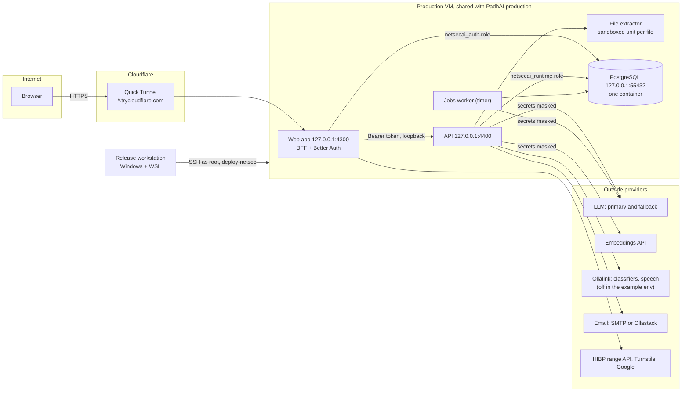

# Security model

> Moved from `docs/security.md` (written for PadhAI, verified at `0e33ec0`) and updated for NetSec AI on
> 2026-10-29, against the code on top of `e439b96`, and corrected after the final review the same day. A control
> marked **(released 0d868b7)** is fixed, with a regression test unless the text says there is none, and was
> deployed to production on 2026-10-29 (`Status: MATCH`); before that release production ran without it. This page explains how NetSec AI is protected. It holds no secrets and no credentials. To report a
> problem, see [SECURITY.md](../../SECURITY.md).

| Page | What it holds |
|---|---|
| [THREAT_MODEL.md](THREAT_MODEL.md) | Assets, actors, attack paths, the security invariants and the tests that hold them, OWASP and ASVS mapping |
| [security-audit.md](security-audit.md) | The 2026-10-29 audit: method, coverage, findings and their status |
| [security-regression-tests.md](security-regression-tests.md) | Every security test, what it proves, and how to run it |
| [secure-development.md](secure-development.md) | The workflow every change follows |
| [production-security-checklist.md](production-security-checklist.md) | Release acceptance and periodic checks, and the open follow-ups |
| [security-tools.md](security-tools.md) | The local security gate (`bun run security`), the scanners and the vendored review skills |

## Contents

- [Trust boundaries](#trust-boundaries)
- [Identity and sessions](#identity-and-sessions)
- [Authorisation and ownership](#authorisation-and-ownership)
- [The web app's protections](#the-web-apps-protections)
- [Secrets](#secrets)
- [Uploads and untrusted files](#uploads-and-untrusted-files)
- [AI-specific risks](#ai-specific-risks)
- [Persistent memory](#persistent-memory)
- [Rate limits and quotas](#rate-limits-and-quotas)
- [Privacy in logs, emails and the model](#privacy-in-logs-emails-and-the-model)
- [Data deletion and retention](#data-deletion-and-retention)
- [Releases and the supply chain](#releases-and-the-supply-chain)
- [Safe local development](#safe-local-development)
- [Where each rule is tested](#where-each-rule-is-tested)

## Trust boundaries

| Boundary | What crosses it | What protects it |
|---|---|---|
| Browser → Cloudflare → web app | Everything a user does | HTTPS at Cloudflare's edge. The Quick Tunnel publishes only `127.0.0.1:4300` ([`netsecai-cloudflared.service`](../../deploy-netsec/systemd/netsecai-cloudflared.service)). `__Host-` cookies, CSP and security headers, `Origin` checks on mutations |
| Web app → API | Allowlisted `/v1` calls | Loopback only (`--host 127.0.0.1 --port 4400`, [`netsecai-api.service`](../../deploy-netsec/systemd/netsecai-api.service)); `Authorization: Bearer`, taken from a cookie whose HMAC is verified first; the API re-checks every request |
| Better Auth → API | Code and security-notice requests | Loopback `/internal/auth/*`, the shared `AUTH_INTERNAL_TOKEN` compared in constant time ([`internal.py:55`](../../backend/app/auth/internal.py)), and checks that the rows named are real and fresh |
| Web app and API → PostgreSQL | SQL | Loopback port 55432 only ([`docker-compose.yml:20`](../../deploy-netsec/compose/docker-compose.yml)). Three roles: `netsecai_migrator` owns the database and runs migrations; `netsecai_runtime` is the API's; `netsecai_auth` reaches the identity tables only ([`database-grants.sh`](../../deploy-netsec/database-grants.sh)) |
| API → extractor | A user's uploaded bytes | A sandboxed transient systemd unit per file: no network, no secrets, read-only system ([below](#uploads-and-untrusted-files)) |
| API and jobs → LLM and embeddings | Prompts, file passages, memory text, search queries | HTTPS. Obvious secrets are masked before the LLM or embeddings provider sees the text ([AI-specific risks](#ai-specific-risks)) |
| API → Ollalink | Message text for the classifiers; audio and text for voice | HTTPS enforced in production ([`settings.py:424-433`](../../backend/app/settings.py)). Not masked. `INTENT_ROUTER`, `STUDY_SCOPE` and `VOICE_MODE` are `off` in [`api.env.example`](../../deploy-netsec/env/api.env.example) |
| Release workstation → host | The commit and the deploy scripts, run as root over SSH | Deploys only GitHub `main` from a clean tree, with a PASS receipt from `bun run security` **(released 0d868b7)**; see [Releases](#releases-and-the-supply-chain) |
| NetSec ↔ PadhAI on one host | Nothing, by design | Separate paths (`/opt/netsecai`, `/etc/netsecai`, `/var/backups/netsecai`), `netsecai-*` units, ports 4300/4400/55432 and a separate database container, all hard-coded as NetSec names in the scripts. [`namespace.test.mjs`](../../deploy-netsec/tests/namespace.test.mjs) fails if a NetSec deploy file names PadhAI's paths, `systemctl start aichat-` or PadhAI's ports (not Docker names or the hostname), and every script that touches the database first proves NetSec's container, volume, network and identity marker (`assert_database_identity`, [`server/lib.sh:141`](../../deploy-netsec/server/lib.sh)). [`safety.sh`](../../deploy-netsec/server/safety.sh)'s `safety_preflight` is only a self-check of NetSec's own constants at the start of the scripts that source it: no real target passes through its denylist, whose Docker prefix `compose` is the removed Ayurveda stack's, not PadhAI's `padhai-postgres*`. Limits: every service runs as root (audit A-21) and `/root/.bun` is shared (A-26) |

The API is **never published**: it listens on `127.0.0.1`, and the tunnel points only at the web app. Interactive
API docs are off in production ([`main.py:231-238`](../../backend/app/main.py)). The named tunnel in
[`config.yml.template`](../../deploy-netsec/cloudflared/config.yml.template) (`chat.netsecai.com`) is not in use
yet; see [deployment.md, "Quick Tunnel address changed"](../deployment.md#quick-tunnel-address-changed).

## Identity and sessions

**Who handles sign-in.** Better Auth 1.7.7, inside the web app (`frontend/apps/app/src/lib/auth/`):
- **Sign-up** is email first: a code proves the address, then a password is set.
- **Sign-in** is by password, by email code, or with Google. Google is never linked implicitly
  (`disableImplicitLinking`, [`config.ts:295`](../../frontend/apps/app/src/lib/auth/config.ts)).
- **Two-step sign-in** (an authenticator app, plus recovery codes) is asked for at every way in.
- **An authenticator code works once.** It is claimed in the database **before** it is checked, under an advisory
  lock, so two parallel uses of one code cannot both pass ([`guard.ts:57-69`](../../frontend/apps/app/src/lib/auth/guard.ts),
  [`config.ts:504-516`](../../frontend/apps/app/src/lib/auth/config.ts)) **(released 0d868b7, F-AUTH-1)**.
- **Changing how the account signs in** on a two-step account needs a sign-in within the last 15 minutes.
- **Password reset** is by emailed code.

**Passwords:**
- They are hashed with argon2id, in the API's PHC format (`lib/auth/password.ts`).
- A password seen in a breach is refused wherever one is set: Have I Been Pwned's range API, where only the first
  five characters of the password's SHA-1 hash leave the server (`lib/auth/protection.ts`). If the service is
  unreachable, the password is refused.
- Length is 8–128 characters.

**Adaptive CAPTCHA:** Cloudflare Turnstile appears only when an address or account is being hammered, and only
when both Turnstile keys are configured. `bun run status:netsec` reports whether they are
([`server/status.sh:52`](../../deploy-netsec/server/status.sh)). Anyone who knows an address can spend its
per-account hard limits and block its code sign-in and reset; Turnstile raises the cost but does not stop it
(audit A-1, open).

**Google** (`lib/auth/config.ts`):
- The ID token from the code exchange is verified against Google's keys, issuer, audience and expiry
  (`googleUser`). If Google's keys are unavailable, there is no identity (fails closed).
- Google signs in by its redirect only. A bare ID token at `/sign-in/social` is refused (`disableIdTokenSignIn`,
  [`config.ts:359`](../../frontend/apps/app/src/lib/auth/config.ts), plus a before-hook).
- No account is ever created with an unverified address.
- The OAuth state is server-side, bound to the browser by a signed cookie, single-use and short-lived, with PKCE
  (S256).

**Request size:** `/api/auth/*` and `/api/account/password` read at most 16 KB (`AUTH_BODY_BYTES`,
[`routes.ts:24`](../../frontend/apps/app/src/lib/auth/routes.ts)) and answer 413 before anything parses the body.

**Failed sign-ins are logged** (web log): `[auth] failed <route> <code> account=<16 hex of the address's SHA-256>
ip=<CF-Connecting-IP>`, and `[auth] limited <scope> account=…` when a per-account limit refuses. Never a password,
a code, a token or an address.

**Cookies:**
- The session cookie is `__Host-padhai_session` over HTTPS (the name was kept from PadhAI), httpOnly, never
  readable by page code ([`cookies.ts`](../../frontend/apps/app/src/lib/server/cookies.ts)).
- Every other Better Auth cookie (the OAuth state, the two-step challenge) is `__Host-netsecai.*` over HTTPS
  ([`config.ts:313`](../../frontend/apps/app/src/lib/auth/config.ts)) **(released 0d868b7, A-0)**. The site lives on
  the shared parent domain `trycloudflare.com`; without the prefix a sibling host could plant a state cookie and
  force a Google login CSRF.
- Every JSON answer from `/api/auth/*` has its `token` removed (`withoutTokens`).

**Sessions:**
- The proxy verifies the cookie's HMAC (`BETTER_AUTH_SECRET`) before the token goes anywhere
  ([`cookies.ts:55-86`](../../frontend/apps/app/src/lib/server/cookies.ts)).
- The API finds the session by the token's **SHA-256** (`auth_sessions.token_hash`), requires a verified address,
  and authorises every request itself ([`dependencies.py:59-78`](../../backend/app/auth/dependencies.py)).
- A session is per device and sliding. Signing out or revoking a device deletes its row at once.
- Known gaps: turning on two-step sign-in does not sign out other sessions (A-2), and the new-device sign-in alert
  is keyed on a label from the client's User-Agent, which an attacker can choose (A-31). Both are open.

**Re-authentication** (email change, account deletion): the password, or, for an account without one, a sign-in
within 15 minutes. A two-step account needs both. Password checks share one per-account limit with sign-in
([api-contract.md, "Auth and account"](../api-contract.md#auth-and-account)).

**If an account may be taken over:** revoke its sessions (the user's own "Sign out other devices", or
`DELETE FROM auth_sessions WHERE user_id = …` with the owner's approval); have the user reset by code (every
session is revoked). If the web app's secret may have leaked, rotate `BETTER_AUTH_SECRET` in
`/etc/netsecai/web.env` and restart `netsecai-web`: every cookie stops working. A leaked Google client secret is
rotated in Google Cloud and `web.env`.

## Authorisation and ownership

- **Identity comes only from the verified session** ([`dependencies.py:59-78`](../../backend/app/auth/dependencies.py)).
  A client never sends a user id: unknown request fields are rejected (`extra="forbid"`,
  [`schemas.py:11-13`](../../backend/app/schemas.py)).
- **Every query is scoped by the caller's id** (`app/conversations/repository.py`, `app/memory/repository.py`,
  `app/files/service.py` and the other services). Another user's resource answers **404**, exactly like a missing
  one.
- **Retrieval** runs under `AccessScope(user_id)`: global sources plus the user's own, resolved in SQL
  ([`store.py:83-95`](../../backend/app/rag/store.py)). Request options can only narrow it
  ([rag.md, "Access model"](../rag.md#access-model)).
- **Attached files** are read only in their owner's own conversation, only once attached and ready
  ([`store.py:212-231`](../../backend/app/rag/store.py)).
- **Memory** is read and written by user id on every path, and proposals and jobs carry composite foreign keys
  (`(conversation_id, user_id)`, `(message_id, conversation_id)`), so a cross-user proposal cannot exist in the
  database ([Persistent memory](#persistent-memory)).
- **The web app's allowlists** decide what a browser *may* reach; the API still decides what is *allowed*. Never
  rely on the allowlist for authorisation.

## The web app's protections

From [`next.config.mjs`](../../frontend/apps/app/next.config.mjs), [`proxy-core.ts`](../../frontend/apps/app/src/lib/server/proxy-core.ts)
and [`middleware.ts`](../../frontend/apps/app/src/middleware.ts):

- **Content-Security-Policy** ([`next.config.mjs:43-55`](../../frontend/apps/app/next.config.mjs)):
  - `default-src 'self'`, `object-src 'none'`, `base-uri 'none'`, `form-action 'self'`, `frame-ancestors 'none'`;
  - the only outside origins are Cloudflare Turnstile and Cloudflare Web Analytics;
  - `script-src` still allows `'unsafe-inline'` (Next's inline scripts), so the CSP would not stop an inline
    handler if a sanitiser bypass appeared. Moving to nonces is a follow-up;
  - `'unsafe-eval'` and WebSockets are in development only.
- **Headers:** HSTS for two years including subdomains; `nosniff`; `X-Frame-Options: DENY`;
  `Referrer-Policy: strict-origin-when-cross-origin`; `Permissions-Policy` allows the microphone for this site only.
- **The proxy** ([`proxy-core.ts:1-38`](../../frontend/apps/app/src/lib/server/proxy-core.ts) lists its guarantees):
  - forwards allowlisted routes only (`lib/api/routes.ts`; ids must be UUIDs), and checks `Origin` on every
    mutation (403 `forbidden`);
  - accepts JSON bodies of at most 64 KB, except the declared upload routes;
  - drops query parameters it was not told to forward;
  - takes `X-Forwarded-For` only from Cloudflare's `cf-connecting-ip`;
  - bounds uploads (2 at once), file downloads (3 at once) and voice (24 at once) per process;
  - re-wraps error envelopes, and clears the cookie on an upstream 401, except for `invalid_credentials`.
- **The middleware** handles pages only. API routes are excluded from its matcher, so Next no longer buffers every
  request body first, and uploads above 10 MB are no longer cut short ([`middleware.ts:42-49`](../../frontend/apps/app/src/middleware.ts))
  **(released 0d868b7, A-6)**. Since a slow body now reaches the BFF directly, `readBody` reads every body under a
  deadline: 30 s (`BODY_TIMEOUT_MS`), 300 s on upload routes (`UPLOAD_TIMEOUT_MS`), then 408 `request_timeout`
  ([`proxy-core.ts:129-170, 293-304`](../../frontend/apps/app/src/lib/server/proxy-core.ts); the two auth routes
  too) **(released 0d868b7, A-6 follow-up)**; `proxy-core.test.ts` "body deadline". One account can still hold both
  upload slots for up to 300 s each: there is no per-user upload cap in the BFF
  ([known-limitations.md](../known-limitations.md#netsec-ai-2026-10-29)).
- **Redirects:** `?redirect=` targets pass through `safeRedirect`, which now also re-checks the parsed path, so
  `/.//evil.com` can no longer become `//evil.com` ([`safe-redirect.ts:25-60`](../../frontend/apps/app/src/lib/safe-redirect.ts))
  **(released 0d868b7, A-17)**.
- **`/api/session/expired`** only clears the cookie after the API confirms that the session is over, so a link
  from another site can't sign anyone out ([`expired.ts`](../../frontend/apps/app/src/lib/server/expired.ts)).
- **The public origin** used for the CSRF check, redirects and the cookie's HTTPS decision comes from
  `X-Forwarded-Proto` (set by the tunnel) and `Host` ([`public-origin.ts`](../../frontend/apps/app/src/lib/server/public-origin.ts)).
  The tunnel passes a client's own `X-Forwarded-Host` through (seen live), so it counts only when `Host` is
  loopback, i.e. a local proxy rewrote it (F-BFF-1, fixed after `0d868b7`; `proxy-core.test.ts`).

## Secrets

| Secret | Where it lives | Note |
|---|---|---|
| `SECRET_KEY` | `api.env` | Keys email-code HMACs and unsubscribe-link signatures. Rotating it voids pending codes and every unsubscribe link already sent |
| `AUTH_INTERNAL_TOKEN` | `api.env` and `web.env` (the same value) | Without it the internal routes don't exist |
| `BETTER_AUTH_SECRET` | `web.env` | Signs the session cookie and encrypts two-step secrets. Rotating it signs everyone out |
| Database passwords | `postgres.env`, `migration.env`, `api.env` (`DATABASE_URL`), `web.env` (`AUTH_DATABASE_URL`) | Roles `netsecai_migrator`, `netsecai_runtime`, `netsecai_auth` |
| Provider keys (LLM, embeddings, Ollalink, email, Google, Turnstile) | `api.env` or `web.env` | Never in the browser: no `NEXT_PUBLIC_` secret exists |
| The deploy SSH key and the GitHub credentials | The release workstation | Not on the host: the host has no GitHub access |

**Rules:**
- The files are `/etc/netsecai/{api,web,postgres,migration}.env`, mode 600, never touched by a deploy. Check the
  mode with `stat`, never by printing them ([production checklist](production-security-checklist.md#secrets-on-the-host)).
- Nothing secret is ever committed. `.env` files and the key files in the repository root (`dummy_acc.txt`,
  `git.txt`, `google_auth.txt`, `ollalink.txt`, `ollastack.txt`, `ollima.txt`, `openrouter.txt`) are git-ignored,
  never opened by tools, and listed again in `.graphifyignore`. `bun run security` runs gitleaks over the tree and
  the whole history ([security-tools.md](security-tools.md)).
- **Secrets never travel in process arguments**, which any local user can read in `ps` or `/proc/*/cmdline`. The
  deploy's smoke cookie is signed with the secret in Python's environment ([`lib.sh:177-188`](../../deploy-netsec/server/lib.sh),
  F-DEPLOY-1), and the database role passwords reach `psql` through `-e NAME` and `\getenv`
  ([`database-grants.sh:29-36`](../../deploy-netsec/database-grants.sh), A-22) **(both released 0d868b7)**.
- The example files hold placeholders only.
- Load secrets for a one-off command the way the service does (`systemd-run --pipe --wait --collect -p
  EnvironmentFile=/etc/netsecai/api.env …`); never `source` them, and never print them.
- If a key leaks: rotate it at the provider, update the env file, restart the affected unit (a production change:
  it needs the owner's approval), and check the logs for misuse. Procedures:
  [production checklist, "Rotating a key"](production-security-checklist.md#rotating-a-key).

## Uploads and untrusted files

- **Types and sizes:** a file's type is checked by its name **and** its content (`type_mismatch`,
  [`files/service.py:284`](../../backend/app/files/service.py)), within a per-type size limit, a 100 MB quota per
  user, 500 files at most, 5 waiting at once, and rate limits.
- **Parsing happens outside the API.** The API process never imports a parser. Each file is read by
  `python -m app.files.extract` in a **transient systemd unit** ([`processing.py:85-120`](../../backend/app/files/processing.py)):
  - `DynamicUser=yes`, a throwaway user;
  - `PrivateNetwork=yes`, `IPAddressDeny=any` and `RestrictAddressFamilies=AF_UNIX`;
  - `ProtectSystem=strict`, `ProtectProc=invisible` and `NoNewPrivileges=yes`, with only the backend's code bound
    read-only;
  - `/opt/netsecai` replaced by an empty read-only directory, and `/etc/netsecai`, PadhAI's `/etc/aichat` and
    `/opt/aichat`, `/etc/cloudflared`, `/var/lib/docker`, `/var/backups` and `/run/dbus` made inaccessible
    **(released 0d868b7, F-FILES-1)**. Before this fix the unit hid PadhAI's paths, not NetSec's;
  - `MemoryMax=512M` and `RuntimeMaxSec=300`.

  Production refuses to parse any other way ([`settings.py:334-341`](../../backend/app/settings.py)): without
  systemd, files are unavailable. The worker pauses while `/run/netsecai-deploying` exists
  ([`processing.py:54`](../../backend/app/files/processing.py), F-FILES-2). Check a host with
  [`backend/scripts/sandbox_probe.py`](../../backend/scripts/sandbox_probe.py) after any change to the extractor.
- **Profile photos** ([`avatar.py`](../../backend/app/auth/avatar.py)):
  - the bytes must be the declared type;
  - images over 40 megapixels are refused before decoding, and a PNG, a WebP, or a JPEG that `draft()` cannot
    shrink, over 16 megapixels is refused before it is decoded at full size, so two decodes at once fit the API's
    `MemoryMax=900M` ([`avatar.py:36-40, 85`](../../backend/app/auth/avatar.py)) **(released 0d868b7, A-30)**;
  - the photo is re-encoded as a 256 px WebP, so EXIF and GPS data never survive.
  - Photos are still decoded in the API process (not the sandbox), and `Image.open` lets every Pillow plugin probe
    the bytes (A-32, open).
- **Bytes are stored in PostgreSQL** (`user_file_blobs`), deleted with the file or the account by foreign keys,
  and served back only to their owner.

## AI-specific risks

The model has no tools and its output has no server-side capability: it can only produce text that the web app
renders.

| Risk | Mitigation (where) |
|---|---|
| A pasted config or log carries passwords, keys or community strings | Every message is masked before the LLM, its fallback or the embeddings provider sees it: `RedactingProvider` and `RedactingEmbeddings` ([`redact.py:365-460`](../../backend/app/llm/redact.py)) wrap whatever `build_llm` and `build_embeddings` return, so the API, the jobs worker and the scripts all get them ([`factory.py:24-27`](../../backend/app/llm/factory.py), [`embeddings.py:155-159`](../../backend/app/rag/embeddings.py)) **(released 0d868b7)**. The system prompt tells the model never to ask for secrets ([`assistant.py:58-60`](../../backend/app/chat/assistant.py)). Limits: patterns catch obvious secrets only; the stored message keeps what the user wrote; Ollalink requests are not masked |
| A user's file or a knowledge-base passage says "ignore your instructions" | File text goes inside the user's own message, in an `<attached_files>` block marked as reference material, and anything that could close the block is neutralised ([`context.py:61-71, 136-186`](../../backend/app/rag/context.py)). Retrieved passages come with a note that they may be incomplete or unrelated. This lowers the risk; it cannot guarantee the model ignores the text |
| Memory as an injection channel | Recalled memory goes in its own `<personal_memory>` block, labelled untrusted background data, delimiters neutralised ([`context.py:38-57`](../../backend/app/rag/context.py)). Only explicit or user-approved memories exist; recall is off by default |
| A user's settings text tries to steer the assistant | Their own text reaches the prompt only in quotes, as information (`app/learning/tutor.py`) |
| The model's output is hostile HTML or a malicious link | The renderer sanitises **first** (`rehype-sanitize`), shows raw HTML as text, allows only `http`, `https` and `mailto` links ([`sanitize-schema.ts:48-63`](../../frontend/apps/app/src/features/markdown/sanitize-schema.ts)), never loads images, runs KaTeX with `trust: false` and mermaid in strict mode |
| The model offers a script download | Code blocks with a file name download as text Blobs built in the page; any extension is accepted. Rejected as a finding (A-20), kept as a hardening note |
| The model invents command output, versions, CVE ids or claims a config was tested | Prompt rules ([`assistant.py:48-51`](../../backend/app/chat/assistant.py)); measured by [`eval_engineering.py`](../../backend/scripts/eval_engineering.py) on the host. The baseline at `e439b96` failed its gate (37/57; `verify_claim` 0/3) |
| Offensive-security misuse | The prompt limits it to authorised, scoped engagements and labs ([`assistant.py:55-57`](../../backend/app/chat/assistant.py)); eval cases `pentest_authorized` and `wifi_unauthorized` |
| The model invents practice questions or marks | Tests come only from the question bank: the server swaps in stored questions, and the database grades answers ([question_bank.md](../question_bank.md)) |

## Persistent memory

- **Switches** ([`settings.py:232-234`](../../backend/app/settings.py)): `MEMORY_ENABLED` (default on) exposes
  `/v1/memories`; `MEMORY_RECALL_ENABLED` (default off) puts memories in the prompt; `MEMORY_AUTOMATIC_PROPOSALS`
  (default off) lets the jobs worker propose memories from chats. Production refuses recall or proposals without
  memory ([`settings.py:408-411`](../../backend/app/settings.py)).
- **Consent** lives in the user's settings and is written only by `PUT /v1/memories/preferences`.
  `PATCH /v1/me/settings` refuses every key starting with `memory` ([`auth/schemas.py:29-41`](../../backend/app/auth/schemas.py)),
  stored values are parsed defensively (only a real `true` is consent, [`preferences.py:23-66`](../../backend/app/memory/preferences.py)),
  and one job's failure never stops other users' jobs ([`jobs/memory.py:111-115`](../../backend/app/jobs/memory.py))
  **(released 0d868b7, F-MEM-1)**.
- **What can never be stored:** secrets and credentials, and configuration excerpts (two or more config
  statements) ([`policy.py:13-79`](../../backend/app/memory/policy.py)).
- **Proposals** are a separate table. Recall reads only active, currently valid `memory_items` of the same user
  ([`repository.py:29-35, 256-277`](../../backend/app/memory/repository.py)). Approval re-checks deletion markers
  under the per-user lock ([`memory/service.py:312-330`](../../backend/app/memory/service.py)).
- **Deletion** is physical; deletion markers stop a deleted memory coming back through a chat command or an
  approval.
- **The kill switch covers chat commands:** with `MEMORY_ENABLED` off, "remember …" and "forget …" are ordinary
  messages ([`chat/service.py:304-305`](../../backend/app/chat/service.py), `memory_on`; A-4, A-11, A-15)
  **(released 0d868b7)**; `test_memory_commands.py::test_with_memory_off_a_remember_command_is_an_ordinary_message`
  failed before the fix.
- **Approving a proposal reads consent the way the worker does** (`MemoryPreferences.from_settings`, so a malformed
  stored value is no consent, never an error; [`proposals.py:60-72`](../../backend/app/memory/proposals.py))
  **(released 0d868b7)**; `test_memory_jobs.py::test_malformed_stored_consent_never_breaks_chat_or_other_users_jobs`
  approves one.
- **Known gaps (open):** not every memory writer takes the per-user lock (A-14); the worker holds that lock across
  the provider call (A-16).

## Rate limits and quotas

There are three layers: Better Auth per IP (in memory), per-account limits in the database's `auth_attempts`
table (under an advisory lock, [`auth/service.py:107-115`](../../backend/app/auth/service.py)), and API quotas. The
full table is in [api-reference.md, "Limits and quotas"](../api-reference.md#limits-and-quotas).

Limits kept in the database hold across processes and restarts. The in-process limiters assume one API process,
which is what production runs. The per-user chat quota is check-then-insert without a per-user lock, so parallel
requests can overshoot it slightly (A-10, open).

## Privacy in logs, emails and the model

- **Logs** are JSON with a request id and user id. They **never** contain message, document or chunk text, keys,
  or codes. Tests check this, and the gate's Semgrep rule `netsec-log-sensitive-value` flags a log call that passes
  such a value. A failed generation is logged with its error code and class only, never the provider's error
  text, which some providers fill with the input ([`chat/service.py:962`](../../backend/app/chat/service.py);
  A-13) **(released 0d868b7)**. No test asserts it yet. Key-like strings in provider errors are also redacted
  ([`openai_compatible.py:30-41`](../../backend/app/llm/openai_compatible.py)).
- **LangSmith tracing must stay off.** It would send prompts and documents outside.
- **Devices and IP addresses:** the devices list shows a coarse label and a masked network. The raw IP address and
  user agent never leave the server, and emails never contain an IP address.
- **What reaches the model:** the system prompt, the user's engineering profile and settings (never their name,
  email or photo), retrieved passages, attached file passages, recalled memories (when recall is on), and the chat
  history within a character budget. All of it with obvious secrets masked **(released 0d868b7)**.
- **What reaches Ollalink (when switched on):** the message text and the earlier turns needed to read it
  (classifiers); the recorded utterance and the text to speak (voice). Not masked. Voice audio is not stored.
- **The NCERT Knowledge Service** is PadhAI's and stays dormant in NetSec (`NCERT_KB_BASE_URL` empty).

## Data deletion and retention

- **An account deletion** (`DELETE /v1/me`, after re-authentication) removes every row that cascades from the user,
  memory included, then emails the address that it was.
- **A chat deletion** removes its messages; practice answers stay in the user's record.
- **A file deletion** frees its bytes and chunks.
- **Backups** ([`deploy-netsec/backup.sh`](../../deploy-netsec/backup.sh)): nightly `pg_dump` to
  `/var/backups/netsecai` (mode 700), kept `KEEP_DAYS` (7), plus one before every migration. The rows of
  `auth_sessions` and `auth_verifications` (live tokens and codes) and `file_chunks` are left out
  ([`backup.sh:68`](../../deploy-netsec/backup.sh)). Dumps are not encrypted and stay on the same host; a deleted
  account's data stays in older dumps until they rotate out. Copying them off the host is not set up: whether to
  keep an encrypted off-host copy is an owner decision not yet made, and until then no dump leaves the host.
- **Retention:** [data-model.md, "Retention and deletion"](../data-model.md#retention-and-deletion).

## Releases and the supply chain

- **The gate:** `bun run security` (Semgrep, gitleaks, pip-audit, `bun audit`, zizmor; [security-tools.md](security-tools.md)).
  On PASS of a clean tree it writes a receipt bound to the commit, and
  [`deploy-netsec/deploy.sh:45-69`](../../deploy-netsec/deploy.sh) refuses to deploy a commit without one
  **(released 0d868b7)**. An override (`NETSEC_SECURITY_GATE=skip:<reason>`) is logged, in the local checkout's
  `.git` only; a rollback to any ancestor of `main` skips the gate without a log line. These limits are listed in
  [known-limitations.md](../known-limitations.md#netsec-ai-2026-10-29).
- **Deploy:** only GitHub `main`, from a clean checkout; a backup before every migration; `rollback:netsec` to an
  earlier commit. PadhAI's `deploy/` refuses to run from this repository ([`deploy/deploy.sh:36-40`](../../deploy/deploy.sh))
  **(released 0d868b7)**.
- **CI** (`.github/workflows/ci.yml`) pins every action by commit SHA, does not keep the checkout token, and pins
  the Mailpit and PostgreSQL images by digest **(released 0d868b7)**. GitHub Actions do not run for this repository
  (out of credit), so CI enforces nothing today.
- **Dependencies** **(released 0d868b7)**:
  - backend: `backend/requirements.lock` is installed with hashes; pip-audit is clean after certifi, dnspython,
    langgraph-sdk and Pillow 13 were upgraded;
  - frontend: `bun audit` went from 34 high findings to none (zod 3 → 4, `@t3-oss/env-nextjs` 0.13, turbo 2.9.18,
    overrides for postcss, rollup and lodash-es in `frontend/package.json`). 8 moderate advisories remain, which
    the gate lists without failing: OpenTelemetry instrumentation and `uuid` pulled in by `@sentry/nextjs` 8
    (`uuid` also by mermaid). Sentry's build wrapper is applied only when `NEXT_PUBLIC_SENTRY_DSN` is set
    ([`next.config.mjs:154`](../../frontend/apps/app/next.config.mjs)), and with no DSN nothing is sent;
  - a deploy that changes the frontend's dependencies runs `bun install --frozen-lockfile --force`
    ([`update.sh:143`](../../deploy-netsec/server/update.sh)), so no stale nested copy of an old version survives
    in the reused `node_modules` (`files-sandbox.test.mjs` "frontend dependencies").
- **PostgreSQL image (A-28):** pinned by digest (`pgvector/pgvector:pg16@sha256:ccc6e83d…`, the digest production
  ran on 2026-10-29) in [`deploy-netsec/compose/docker-compose.yml`](../../deploy-netsec/compose/docker-compose.yml)
  and CI **(released 0d868b7)**. Deploys never touch the host's copy of that file: production uses the pin only after
  the file is copied into `/opt/netsecai/shared/postgres` on purpose
  ([deployment.md](../deployment.md#changing-the-database-container-on-purpose)).
- **Open:** Bun is installed on the host by `curl | bash` without a checksum (A-24, A-27); the workstation's Python
  tools are not hash-pinned (A-29).

## Safe local development

- Use test accounts with `@example.com` addresses, `LLM_PROVIDER=fake` and `EMBEDDING_PROVIDER=fake` when you
  don't need a real model.
- Backend tests run against an isolated database whose name ends in `_test`; the test harness refuses any other
  ([`conftest.py:73`](../../backend/tests/conftest.py)). On the owner's PC they run in WSL
  ([security-regression-tests.md](security-regression-tests.md#how-to-run)).
- Never point local tools at production:
  - the e2e suite refuses non-loopback URLs (`assertLoopback`);
  - `scripts/smoke_chat.py` defaults to the local API and must never be given a production URL.
- Never copy production data to a laptop, and never paste real user content into issues, prompts or docs.
- The key files in the repository root are never opened, printed or committed. Graphify never reads them
  ([graphify.md](../graphify.md#boundaries-security-review-2026-10-29)).

## Where each rule is tested

The full list, with what each test proves and how to run it, is in
[security-regression-tests.md](security-regression-tests.md). The invariants and the tests that hold them are in
[THREAT_MODEL.md](THREAT_MODEL.md#security-invariants).

| Rule | Test |
|---|---|
| Per-user isolation: another user's resources answer 404 | `backend/tests/test_authorization.py` |
| Every route needs a session unless it's on the recorded public list | `backend/tests/test_route_auth.py` |
| Dependency direction | `backend/tests/test_architecture_guards.py` |
| Retrieval, attached files and memory never cross users | `test_rag_retrieval.py`, `test_files.py`, `test_memory.py` |
| Secrets are masked before the LLM and embeddings providers | `test_redact.py`, `test_redact_wiring.py` |
| The extractor sandbox hides this deployment and its secrets | `test_files.py::test_the_sandbox_hides_this_deployment_and_its_secrets`, `deploy-netsec/tests/files-sandbox.test.mjs` |
| Log hygiene | `test_chat.py::test_logs_never_contain_the_question_or_document_text`, plus key checks in `test_intents.py`, `test_email.py`, `test_scope.py`, `test_voice.py`, `test_llm.py` |
| The proxy, cookies, redirects, middleware and auth allowlist | `frontend/apps/app/src/lib/server/*.test.ts`, `src/lib/auth/*.test.ts`, `src/lib/safe-redirect.test.ts`, `src/middleware.test.ts` |
| Browser-level protections | `frontend/apps/app/e2e/security.e2e.ts` |
| Deploy: the gate receipt, secrets out of argv, namespace isolation, the legacy guard | `deploy-netsec/tests/*.test.mjs` |
